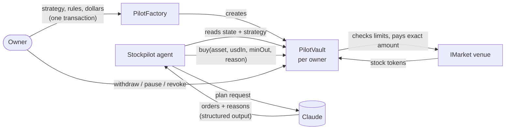

# Stockpilot

**An AI agent buys tokenized stocks for you, inside limits a smart contract enforces.**

You write a strategy in plain English ("buy TSLA and AMZN every week, more of whichever is down"), fund a vault
with dollars, and set the rules: which stocks, how much per trade, how much per week. Claude plans each buy. Your
vault contract checks every one. The agent can buy only what you allowed, only within your budget, only at a fair
price, and it can never withdraw. Every trade carries its one-line reason on-chain.

Built for [Colosseum's Crypto World's Fair](https://www.colosseum.com/worldsfair) (Robinhood Chain and Arbitrum
tracks).

[](https://github.com/ramadan904/ade/actions/workflows/ci.yml)

## Why

Tokenized stocks on Robinhood Chain make equities programmable: buyable around the clock, in any amount, by a
contract. AI agents are good at turning "what I want" into "what to do". Joining the two today means handing an
agent a wallet, and a wallet is all or nothing: the key that can buy $50 of Tesla can also send everything to
anyone.

Stockpilot splits the two. The **agent decides**. The **vault enforces**. The rules live in a contract the owner
controls, not in a prompt or a server, so a confused model, a prompt injection or a stolen agent key can at worst
make allowed buys within the owner's budget.

## What the agent cannot do

Each line is enforced by `PilotVault` on every buy, and each has a test that tries to break it.

| Guarantee | How | Tested by |
| --- | --- | --- |
| Never withdraw or move funds out | The agent can call `buy`, nothing else. `withdraw` is owner-only. | `test_onlyOwnerCanWithdrawAndConfigure`, e2e "compromised agent" step |
| Only buy stocks the owner allowed | Owner-managed allowlist | `test_disallowedAssetIsRefused`, invariant `agentGetsNothing` |
| Stay within a per-trade cap | `OverTradeLimit` | `test_overTradeLimitIsRefused` |
| Stay within a budget per period (e.g. weekly) | Spend is tracked per period; refills when the period ends | `test_budgetIsEnforcedAcrossTradesAndRefillsNextPeriod`, invariant `budgetPerPeriodHolds` |
| No bad fills | `minOut` must be within the owner's slippage limit of the market quote, and the vault checks its own balance after the trade | `test_minOutBelowSlippageFloorIsRefused`, `test_shortchangingMarketIsCaught` |
| A hostile market cannot drain the vault | Exact approval, reset to zero after each trade; reentrancy guard | `test_greedyMarketCannotPullMoreThanApproved`, `test_reentrantMarketIsBlocked`, invariant `noDanglingApproval` |
| Stops when told | Owner can pause or revoke the agent at any time | `test_pausedVaultRefusesBuys`, `test_revokedAgentCannotBuy` |
| No trading on stale prices | The demo market refuses prices older than `maxPriceAge` | `test_stalePriceStopsTheAgent` |

## How it works



1. **Open a vault.** One transaction through `PilotFactory` creates the owner's `PilotVault`, sets its rules and
   strategy, and funds it.
2. **The agent runs** on a schedule. For every vault that names it, it reads cash, budget left, prices, holdings,
   the owner's strategy and its own past trades, and asks Claude for a plan as structured JSON.
3. **Two layers of checks.** The agent's own guard trims or drops any order that breaks the rules (so a bad plan
   costs no gas and the owner sees why). The vault then enforces the same rules on-chain, whatever the agent sends.
4. **Each buy is simulated, then sent,** with Claude's reason stored in the `Bought` event. The web app shows them as
   an activity feed, so the owner can audit every decision.

Without an API key the agent uses a deterministic planner (even split of the period's budget), so the whole system
runs and is tested without Claude.

## Try it locally (2 minutes)

Needs [Foundry](https://getfoundry.sh), Node 20+ and Python 3.

```bash
git clone --recursive https://github.com/ramadan904/ade && cd ade
export ANTHROPIC_API_KEY=...   # optional: plan with Claude instead of the rules planner
scripts/demo.sh
```

This starts a local chain, deploys everything with five test stock tokens (TSLA, AMZN, PLTR, NFLX, AMD), runs a
price keeper that moves prices, runs the agent every 30 s, and serves the web app at
<http://127.0.0.1:4173/web/>. Click **Connect wallet** (a local dev account, no extension needed), get test dollars,
create a vault, and watch the agent's trades appear.

## Deploy to Robinhood Chain testnet

1. Get testnet ETH and test stock tokens from the [Robinhood Chain faucet](https://faucet.testnet.chain.robinhood.com).
2. Deploy. With no `STOCK_TOKENS` the script deploys test stock tokens; to use Robinhood's own test stock tokens,
   pass their addresses and prices (dollars, 8 decimals):

   ```bash
   cd contracts
   STOCK_TOKENS=0x...,0x... STOCK_PRICES=25000000000,18000000000 \
     forge script script/Deploy.s.sol --rpc-url https://rpc.testnet.chain.robinhood.com/rpc \
     --broadcast --private-key $DEPLOYER_KEY
   ```

   This writes `contracts/deployments/46630.json`. With real stock tokens, transfer some to the market address as
   inventory. Add `"agent": "0x<your agent address>"` to the JSON so the web app prefills it.
3. Run the keeper and the agent against it:

   ```bash
   cd agent && cp .env.example .env   # set RPC_URL, AGENT_PRIVATE_KEY, KEEPER_PRIVATE_KEY, ANTHROPIC_API_KEY
   npm ci
   npm run keeper -- --refresh        # or --set TSLA=251.20,AMZN=179.90
   npm run agent -- --all --loop 3600
   ```

4. Serve the repository root (any static host, e.g. GitHub Pages or Vercel) and open `/web/` with a browser wallet.

The same steps work on Arbitrum Sepolia (`https://sepolia-rollup.arbitrum.io/rpc`, chain 421614).

## Repository

| Path | What |
| --- | --- |
| `contracts/src/PilotVault.sol` | The vault: owner's rules, agent's single `buy` entry point |
| `contracts/src/PilotFactory.sol` | One-transaction vault creation, vault registry for the agent |
| `contracts/src/interfaces/IMarket.sol` | The venue seam: adapters for real venues implement this |
| `contracts/src/venues/OracleMarket.sol` | Demo venue: sells from inventory at keeper-posted prices plus a spread, refuses stale prices |
| `contracts/test/` | Unit, fuzz, hostile-market and invariant tests |
| `contracts/script/Deploy.s.sol` | Deploys market and factory, writes `deployments/<chainId>.json` |
| `agent/src/plan.ts` | Claude planner (structured output), rules planner, and the guard |
| `agent/src/run.ts` | Agent CLI: one vault, all vaults that name it, or a loop |
| `agent/src/keeper.ts`, `agent/src/create-vault.ts` | Price keeper and vault creation from the command line |
| `agent/test/` | Guard and planner tests, ABI drift test, end-to-end test on a local chain, browser test of the web app |
| `web/` | The web app: static HTML/JS, no build step for visitors (`web/vendor/lib.js` is bundled from `agent/src/web-lib.ts`) |
| `scripts/demo.sh` | The local demo |

## Tests

```bash
cd contracts && forge test        # 33 tests: unit, fuzz (512 runs), invariants (128 runs x 64 calls)
cd agent && npm test              # 16 tests, including end-to-end on anvil and a Chromium run of the web app
```

The end-to-end test opens a vault, lets the agent trade, then plays a **compromised agent** that skips its own
guard and sends a disallowed stock, an oversized order and an over-budget order straight to the vault, and tries
to withdraw: every one is refused by the contract by name (`AssetNotAllowed`, `OverTradeLimit`, `OverBudget`,
`NotOwner`), and the vault's dollars are untouched. CI runs all of it on every push.

## Status and limits

- **Test networks only. Not audited.**
- **The market is a demo venue.** `OracleMarket` sells from its own inventory at prices a keeper posts. It exists
  so the system runs end to end on a testnet. Production vaults would point at an `IMarket` adapter for a real
  venue (an AMM pool or an RFQ desk for stock tokens), and the vault's balance check and slippage bound do not trust
  the venue either way.
- **Buys only.** Selling and rebalancing are left out on purpose: a buy-only agent that cannot withdraw has the
  smallest possible blast radius. Sells into the vault's own dollars are the natural next step.
- Robinhood Chain testnet and Arbitrum Sepolia deployments are scripted but not yet published from this repository.

## Where this goes

- **Product:** recurring investing that understands intent, for people who want "invest $100 a week in the
  companies I believe in" without picking dates and amounts. Revenue from a small annual fee on assets under
  management, charged by the vault, or a flat subscription for the hosted agent.
- **Next:** a real venue adapter, sells and rebalancing under the same guardrails, Paxos USDG as the dollar on
  Robinhood Chain and Arbitrum One, notifications for every trade, and an owner-side assistant ("why did you buy
  AMZN today?") that answers from the on-chain memos.
- **Beyond stocks:** the vault pattern (an agent that can act but not withdraw, within owner-set limits, explaining
  itself on-chain) fits any agent that spends money for someone.

## Hackathon disclosure

Crypto World's Fair judges work done between September 14 and October 12, 2026. All Stockpilot code in this
repository (`contracts/`, `agent/`, `web/`, `scripts/`) was written from October 5, 2026 onward, as the git history
shows. Related earlier work by the same builder, from October 1 to 4, 2026, is
[create-stylus-latest](https://github.com/ramadan904/npx-create-stylus-latest), a scaffolding CLI for Arbitrum
Stylus contracts with AI-agent tooling; Stockpilot reuses ideas from it (spending limits enforced before signing,
errors decoded by name) but no code. `newsletter/` is an unrelated page that predates this project.

## License

MIT
